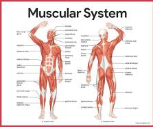

# Gimnasio

## Miembros del grupo L3-ABS-2

1. Gallego Cal, Guillermo
1. Sanchez Gonzalez, Alejandro
1. Khattabi El Inani, Ilias
1. Apellidos, Nombre

## 1. Introducción al problema

- Descripción del problema para poner en contexto el proyecto, incluyendo información sobre los clientes y usuarios, la situación actual, problemas, expectativas, etc. Se valorará la presencia de información multimedia (fotos, gráficos, documentos escaneados, etc.).

## 2. Glosario de términos

### A

Actividad deportiva: Ejercicio o práctica física que se realiza para mejorar la condición física, desarrollar habilidades o mantener un estilo de vida saludable. En el gimnasio, puede realizarse de forma individual o mediante clases dirigidas.

### C

Clase dirigida: Actividad deportiva organizada e impartida por un entrenador, con una duración, un horario y una capacidad máxima determinados.

Capacidad máxima: Número máximo de personas que pueden utilizar una sala o participar en una clase de forma simultánea, según los límites establecidos.

### E

Entrenador: Profesional encargado de dirigir actividades deportivas, orientar a los socios durante el ejercicio y supervisar el desarrollo de las clases que tiene asignadas.

Estado: Situación actual de un elemento del sistema, como una matrícula, una reserva, un pago o una máquina. Permite identificar su condición en un momento determinado.

### G

Gimnasio: Instalación destinada a la práctica de ejercicio físico y actividades deportivas que dispone de espacios, equipamiento y profesionales para atender a sus usuarios.

### H

Horario: Intervalo de tiempo establecido para determinar cuándo comienza y termina una clase o actividad deportiva.

### M

Mantenimiento de la matrícula: Control de la vigencia de la inscripción de un socio en el gimnasio, teniendo en cuenta sus fechas de inicio y finalización y su estado.

Matrícula: Registro que vincula a un socio con un plan de membresía durante un periodo determinado y establece las condiciones de su inscripción en el gimnasio.

Máquina de musculación: Equipamiento deportivo diseñado para realizar ejercicios de fuerza y trabajar uno o varios grupos musculares.

Músculo: Tejido del cuerpo humano que permite producir movimiento mediante su contracción. En el ámbito del entrenamiento, los músculos se agrupan según las zonas del cuerpo que se trabajan durante los ejercicios: pierna, brazo, pecho y espalda.

### P

Pago: Operación económica mediante la cual un socio abona una cantidad correspondiente a los servicios o a la membresía del gimnasio.

Plan de membresía: Modalidad de inscripción que establece las condiciones económicas y temporales de acceso a los servicios del gimnasio, como su precio y duración.

### R

Reserva: Registro mediante el cual un socio solicita una plaza para participar en una clase dirigida. Su gestión permite controlar las plazas disponibles y la asistencia prevista.

### S

Sala: Espacio físico del gimnasio destinado a la realización de actividades deportivas o a la ubicación de equipamiento de entrenamiento.

Socio: Persona inscrita en el gimnasio que dispone de una matrícula asociada a un plan de membresía.

## 3. Visión general del sistema

### 3.1. Requisitos generales

### 3.2. Usuarios del sistema

Los usuarios del sistema son aquellas personas las cuales van a utilizar la aplicación y realizar operaciones con ella. En nuestro sistema de gestión del  Gimnasio, tenemos tres usuarios posibles, que son el administrador del gimnasio, el socio y el entrenador. Cada uno tendrá diferentes responsabilidades y funcionalidades según su papel dentro del gimnasio.

El administrador del gimnasio es quien gestiona la información general del gimnasio. Tendrá acceso a las funciones de gestión de socios, planes de membresía, matrículas, entrenadores, clases, salas, horarios y pagos. Su función principal será garantizar el correcto funcionamiento y la organización de las actividades del gimnasio.

El socio será el usuario que esté inscrito en el gimnasio y utilice el sistema para consultar y gestionar su actividad. Podrá consultar el estado y la fecha de finalización de su matrícula, visualizar las clases disponibles y sus horarios, realizar o cancelar reservas y consultar la información de sus pagos.

El entrenador será el profesional encargado de impartir las clases y actividades del gimnasio. A través del sistema podrá consultar las clases que tiene asignadas, revisar sus horarios y las salas en las que se desarrollan, así como consultar las reservas de sus clases para conocer la asistencia prevista.

## 4. Catálogo de requisitos

### 4.1. Requisitos funcionales

#### R.F.01. Gestión de socios
-   Como administrador del gimnasio quiero registrar, modificar y consultar los datos de los socios para mantener actualizada su información personal.

#### R.F.02. Gestión de planes
-   Como administrador del gimnasio quiero crear, modificar y consultar los planes de membresía para gestionar las diferentes opciones disponibles para los socios.

#### R.F.03. Gestión de matrículas
-   Como administrador del gimnasio quiero registrar y gestionar las matrículas de los socios, indicando el plan, la fecha de inicio y la fecha de fin para
  controlar la vigencia de sus membresías.

#### R.F.04. Consulta del estado de la matrícula
-   Como socio quiero consultar el estado y la fecha de finalización de mi matrícula para saber si mi membresía está activa y cuándo caduca.

#### R.F.05. Gestión de entrenadores
-   Como administrador del gimnasio quiero registrar y gestionar los datos de los entrenadores y su especialidad para mantener actualizada la información del personal encargado de las clases.

#### R.F.06. Gestión de clases
-   Como administrador del gimnasio quiero crear y gestionar las clases, indicando su nombre, descripción, duración, capacidad máxima, y entrenador para organizar la oferta de actividades del gimnasio.

#### R.F.07. Gestión de salas
- Como administrador del gimnasio quiero registrar y gestionar las salas, indicando su capacidad y ubicación para organizar los espacios donde se realizan las clases.

#### R.F.08. Gestión de horarios
- Como administrador del gimnasio quiero establecer y consultar los horarios de las clases para organizar la programación de actividades del gimnasio.

#### R.F.09. Gestión de reservas
- Como socio quiero reservar y cancelar mi asistencia a las clases para poder organizar mi participación en las actividades del gimnasio.

#### R.F.10. Gestión de pagos
- Como administrador del gimnasio quiero registrar y consultar los pagos realizados por los socios, indicando el importe, la fecha, el método de pago y el estado para llevar un control de los pagos y de las matrículas.

**Prueba de aceptación**
- Descripción de la primera comprobación a realizar
- Descripción de la segunda comprobación a realizar
- Se debe aplicar la regla de negocio R.N.XX.
- ...

#### 4.1.1. Requisitos de información

##### R.I.01. Título requisito de información

Como [tipo de usuario]
quiero [servicio]
para [razón]

**Prueba de aceptación**
- Descripción de la primera comprobación a realizar
- Descripción de la segunda comprobación a realizar
- ...

#### 4.1.2. Reglas de negocio

##### R.N.01. Matrícula activa para realizar reservas
-   Un socio debe tener una matrícula activa para poder realizar una reserva en una clase.

##### R.N.02. Una única matrícula activa
-   Un socio no puede tener más de una matrícula activa al mismo tiempo.

##### R.N.03. Asignación de clases
-   Cada clase debe estar asociada a un entrenador, una sala y un horario determinado.

##### R.N.04. Capacidad máxima de las clases
-   El número de reservas de una clase no puede superar la capacidad máxima de la sala donde se realiza.
  
##### R.N.05. Restricciones para realizar reservas
-   Un socio no puede reservar una clase cuyo horario ya haya comenzado ni realizar una reserva cuando su matrícula se encuentre caducada.
### 4.2. Mapa de historias de usuario (opcional)

### 4.3. Requisitos no funcionales (opcional)

**R.N.F. 01. Título requisito no funcional**
Como [tipo de usuario]
quiero [servicio]
para [razón]

-- fin entregable 1 --

## 5. Modelo conceptual

### 5.1. Diagramas de clases UML

- con restricciones.

### 5.2. Escenarios de prueba

- con descripción textual y diagrama de objetos UML.

## 6. Matrices de trazabilidad

- Matriz de trazabilidad entre los elementos del modelo conceptual y los requisitos.

|       | EntidadX   | AsociaciónX  | RestricciónX  | Entidad2 ...   | 
|:------|:-----------|:-----------|:-----------|:-----------|
| RI-1  | X          | X          | X          | X          |
| RI-2  |            | X          |            | X          |
| RF-1  |            | X          |            | X          |
| RF-2  | X          |            | X          | X          |
| RN-1  |            | X          |            |            |
| RN-2  | X          | X          | X          |            |
| ...   |            |            |            |            |

-- fin entregable 2 --

## 7. Modelo relacional en 3FN

- Relaciones obtenidas al aplicar la transformación del modelo conceptual.

### 7.1.  Justificación de la estrategia de transformación de jerarquías

- si se identificaron jerarquías en el MC.

### 8. Matriz de trazabilidad MC/SQL (opcional):

- Restricciones sobre el MC / Elementos del modelo tecnológico (SQL) (Triggers, checks, etc.)
- Incluir Reglas de negocio — Constraints/Triggers en las matrices de trazabilidad para el entregable 3

|       | EntidadX   | AsociaciónX  | RestricciónX  | Entidad2 ...   | 
|:-------|:-------|:-------|:-------|:-------|
| TABLA-1 |        |        |        |        |
| TABLA-2 |        |        |        |        |
| TABLA-3 |        |        |        |        |
| TABLA-4 |        |        |        |        |
| TRIG-1 |        |        |        |        |
| TRIG-2 | X      | X      |        | X      |
| TRIG-3 |        | X      |        | X      |
| TRIG-4 |        |        | X      |        |
| CONST-1 |        |        |        |        |
| CONST-2 | X      | X      |        | X      |
| CONST-3 |        | X      |        | X      |
| CONST-4 |        |        | X      |        |

Se consideran todo tipo de constraints declarativas (aquellas definidas durante el CREATE TABLE).
-- fin entregable 3 --

## Referencias

